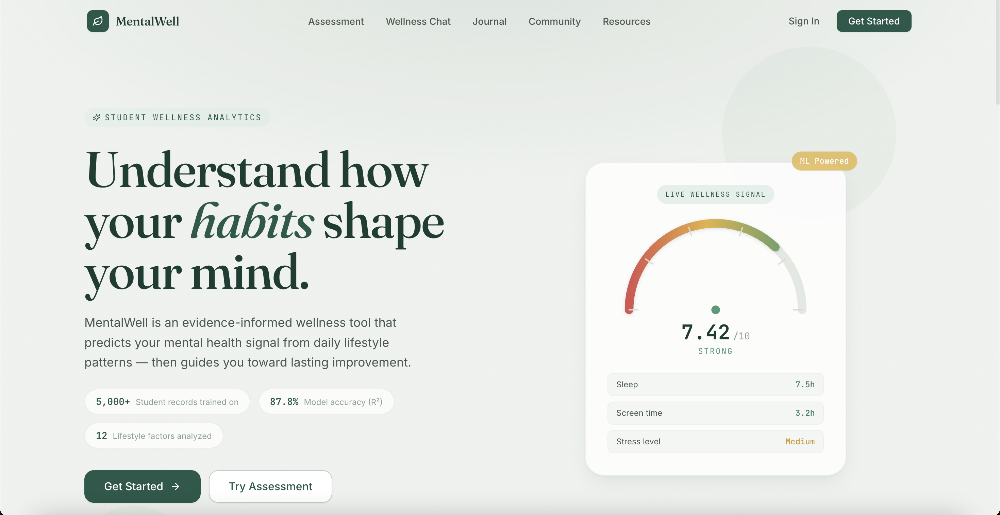

# MentalWell — AI-Based Student Mental Health Prediction & Wellness Platform

[](https://fastapi.tiangolo.com/)
[](https://react.dev/)
[](https://vitejs.dev/)
[](https://www.mongodb.com/)
[](https://scikit-learn.org/)
[](https://ai.google.dev/)
[](https://tailwindcss.com/)
[](https://jwt.io/)

> **MentalWell** is an end-to-end full-stack wellness analytics platform designed for students. By analyzing 12 daily digital habits, screen time, academic pressure, and lifestyle patterns, MentalWell predicts an objective Mental Health Score (0–10) using a trained Random Forest Regressor and guides students with an AI wellness chatbot, daily mood journaling, and an anonymous peer support community.

---

## 🌟 Landing Page Preview



---

## 📑 Table of Contents

- [Core Features](#-core-features)
- [Machine Learning Engine](#-machine-learning-engine)
- [System Architecture](#-system-architecture)
- [Tech Stack](#-tech-stack)
- [Project Directory Structure](#-project-directory-structure)
- [API Endpoints Reference](#-api-endpoints-reference)
- [Quick Start Guide](#-quick-start-guide)
  - [Prerequisites](#prerequisites)
  - [1. Backend Setup](#1-backend-setup)
  - [2. Frontend Setup](#2-frontend-setup)
- [Default Test Credentials](#-default-test-credentials)
- [Disclaimer](#-disclaimer)

---

## 💡 Core Features

### 1. 🧠 ML Mental Health Assessment
* **12-Factor Predictive Survey:** Students enter daily habits including social media hours, daily phone unlocks, study hours, sleep quality, physical activity, and subjective stress levels.
* **Instant ML Inference:** The backend feeds the data directly into a pre-trained scikit-learn pipeline, producing a continuous **Mental Health Score (0.0 to 10.0)**.
* **Visual Score Gauge:** Results are visualized with animated gauges, categorical wellness bands (*Strained*, *Balanced*, or *Strong*), and tailored advice.
* **Prediction History:** Authenticated students can review historical assessment trends over time.

### 2. 📊 Student Wellness Dashboard
* **Dynamic Welcome & Metrics:** Shows the user's latest score, current day streak, recent assessment logs, and sleep balance.
* **Guided Breathing Exercise:** Interactive 4-7-8 breathing circle animation with visual and timing cues for immediate stress relief.
* **Smart Wellness Insights:** Contextual lifestyle suggestions generated from recent inputs and sleep/screen-time ratios.

### 3. 💬 Gemini AI Wellness Coach
* **Conversational Support:** Powered by Google's Gemini generative AI model, providing empathetic, non-judgmental guidance for academic burnout, exam stress, and habit improvement.
* **Session Memory:** Multi-turn conversational memory with persistent chat sessions saved in MongoDB.
* **Safety Guardrails:** Pre-configured system instructions that maintain a supportive coaching tone and detect crisis cues with safety helpline recommendations.

### 4. 👥 Peer Support Community
* **Student Discussion Feed:** Students share experiences, academic challenges, and emotional wins.
* **Category Filters:** Filter posts by *Academics*, *Anxiety*, *Depression*, *Relationships*, *Sleep*, *Social Media*, *Self-Care*, and *General*.
* **Anonymous Posting:** Students can toggle "Post Anonymously" to safeguard privacy while seeking help. Real author identities are never leaked to other users.
* **Support Reactions & Comments:** Express solidarity with one-click heart reactions and supportive comment threads.

### 5. 📓 Daily Mood & Reflection Journal
* **Mood Tracking:** Tag reflections with 5 core moods (*Great*, *Good*, *Neutral*, *Low*, *Tough*).
* **Gratitude & Journaling:** Rich textarea for writing daily logs with real-time word count and search filtering.
* **Personal & Secure:** Entries are strictly private to the authenticated author.

### 6. 🔐 Secure Authentication & User Management
* **Modern Cryptography:** Passwords hashed with **Argon2id** via `pwdlib` — plaintext passwords are never stored or exposed.
* **Stateless JWT Authorization:** Fast access token validation with configurable expiration.
* **Client Persistence:** React `AuthContext` with automatic login restoration across page reloads.

---

## 🔬 Machine Learning Engine

| Attribute | Specification |
| :--- | :--- |
| **Model Type** | `RandomForestRegressor` within an end-to-end `sklearn.pipeline.Pipeline` |
| **Trained Artifact** | `Mental_Health_Model.pkl` (~25.6 MB) |
| **Training Dataset** | `Student Social Media And Mental Health Impact.csv` (5,000+ records) |
| **Input Features** | 12 features (Age, Gender, Country, Academic Level, Most Used Platform, Purpose, Daily Usage Hours, Unlocks, Study Hours, Physical Activity, Sleep, Stress Level) |
| **Preprocessing** | Numerical median imputation, categorical one-hot encoding, country frequency grouping |
| **Output Target** | Continuous Mental Health Score between `0.0` and `10.0` |

### Score Classification Bands
* **Strained (`0.0 – 4.9`):** High digital strain, elevated stress, or low sleep. Requires rest, reduced screen time, and grounding habits.
* **Balanced (`5.0 – 6.9`):** Stable day-to-day rhythm with room to optimize physical activity and sleep hygiene.
* **Strong (`7.0 – 10.0`):** Resilient wellness foundation with healthy boundaries around technology, academics, and recovery.

---

## 🏗 System Architecture

```
┌─────────────────────────────────────────────────────────────┐
│                 React 18 Frontend (Vite)                    │
│      Tailwind CSS • AuthContext • Lucide UI Components      │
└──────────────┬───────────────────────────────▲──────────────┘
               │ HTTP / JSON (Axios)           │
               ▼                               │ Responses
┌──────────────────────────────────────────────┴──────────────┐
│                    FastAPI Backend                          │
│   ┌─────────────────────────────────────────────────────┐   │
│   │           API Routers (prefix: /api/v1)             │   │
│   │  /auth  •  /predictions  •  /dashboard  •  /chat    │   │
│   │  /community  •  /journals  •  /health               │   │
│   └──────────────────────┬──────────────────────────────┘   │
│                          │                                  │
│           ┌──────────────┴──────────────┐                   │
│           ▼                             ▼                   │
│  ┌─────────────────┐           ┌─────────────────┐          │
│  │  PyMongo Async  │           │ Scikit-Learn ML │          │
│  │   MongoClient   │           │ Pipeline Loader │          │
│  └────────┬────────┘           └────────┬────────┘          │
└───────────┼─────────────────────────────┼───────────────────┘
            ▼                             ▼
┌────────────────────────┐   ┌────────────────────────┐
│    MongoDB Database    │   │ Mental_Health_Model    │
│  (Users, Predictions,  │   │     (.pkl file)        │
│   Journals, Chats,     │   └────────────────────────┘
│      Community)        │
└────────────────────────┘
```

---

## 💻 Tech Stack

### Frontend
* **Core:** React 18, Vite 6
* **Routing:** React Router DOM v6
* **Styling:** Vanilla CSS design tokens + Tailwind CSS 3.4
* **Typography:** Fraunces (Display serif), Inter (Body sans), JetBrains Mono (Code/Metrics)
* **Icons:** Lucide React

### Backend
* **Web Framework:** FastAPI (Python 3.10+)
* **ASGI Server:** Uvicorn with auto-reload
* **Database Driver:** PyMongo Async (`AsyncMongoClient`)
* **Validation & Settings:** Pydantic v2 & Pydantic Settings
* **Authentication:** PyJWT, `pwdlib` with Argon2id hasher
* **AI Integration:** Google Gemini API (`google-generativeai`)
* **Machine Learning:** Scikit-learn, Joblib, Pandas, NumPy

---

## 📁 Project Directory Structure

```
Mental-Health-Score/
├── Mental_Health_Model.pkl                     # Serialized scikit-learn ML pipeline
├── ML_Project.ipynb                            # Training notebook & exploratory data analysis
├── Student Social Media And Mental Health...   # Benchmark student dataset (CSV)
├── main.py                                     # Standalone root inference script
├── requirements.txt                            # Root dependencies
├── PROJECT_STRUCTURE.md                        # Technical architectural documentation
├── README.md                                   # Project documentation (this file)
│
├── docs/                                       # Project documentation assets
│   └── assets/
│       └── landing-page.png                    # Landing page preview screenshot
│
├── backend/                                    # FastAPI Backend Service
│   ├── app/
│   │   ├── core/                               # Config, DatabaseManager, Security, ModelLoader
│   │   ├── db/                                 # MongoDB index initializers
│   │   ├── routers/                            # Auth, Predictions, Dashboard, Journal, Chat, Community
│   │   ├── schemas/                            # Pydantic v2 validation models
│   │   ├── services/                           # Business logic layer
│   │   └── main.py                             # FastAPI entry point & lifespan events
│   ├── scripts/
│   │   └── reset_password.py                   # CLI tool to list users & reset passwords
│   ├── tests/                                  # Pytest automated test suites
│   ├── requirements.txt                        # Backend dependencies
│   └── .env                                    # Environment variables
│
└── frontend/                                   # React + Vite Frontend
    ├── public/                                 # Favicon, static assets
    ├── src/
    │   ├── api/                                # Modular API service clients
    │   ├── components/                         # Reusable UI components & layouts
    │   ├── context/                            # AuthContext provider & hooks
    │   ├── pages/                              # Page views (Dashboard, Assessment, Chat, Community, etc.)
    │   ├── App.jsx                             # Application route definitions & guards
    │   ├── main.jsx                            # React DOM initialization
    │   └── index.css                           # Global Tailwind styles & color tokens
    ├── package.json                            # Scripts & dependencies
    ├── vite.config.js                          # Vite configuration & backend proxy
    └── tailwind.config.js                      # Tailwind design system configuration
```

---

## 📡 API Endpoints Reference

All application endpoints are versioned under `/api/v1`:

| Method | Endpoint | Description | Auth Required |
| :--- | :--- | :--- | :---: |
| `GET` | `/api/v1/health` | Service health, model status, MongoDB status | No |
| `POST` | `/api/v1/auth/register` | Register new user account | No |
| `POST` | `/api/v1/auth/login` | Authenticate user & return JWT token | No |
| `GET` | `/api/v1/auth/me` | Fetch authenticated user profile | **Yes** |
| `POST` | `/api/v1/predict` | Backward-compatible standalone prediction | No |
| `POST` | `/api/v1/predictions` | Calculate & store mental health assessment | **Yes** |
| `GET` | `/api/v1/predictions` | Retrieve user's historical predictions | **Yes** |
| `GET` | `/api/v1/dashboard/summary` | Aggregated dashboard stats, streak & metrics | **Yes** |
| `GET` | `/api/v1/journals` | List user's journal entries | **Yes** |
| `POST` | `/api/v1/journals` | Create a new journal entry | **Yes** |
| `POST` | `/api/v1/chat/message` | Send message to Gemini AI coach | **Yes** |
| `GET` | `/api/v1/chat/sessions` | List user's chat history sessions | **Yes** |
| `GET` | `/api/v1/community/posts` | Paginated peer support community feed | **Yes** |
| `POST` | `/api/v1/community/posts` | Create new post (supports anonymous) | **Yes** |
| `POST` | `/api/v1/community/posts/{id}/support` | Toggle heart reaction on post | **Yes** |
| `POST` | `/api/v1/community/posts/{id}/comments` | Post comment on community post | **Yes** |

---

## 🚀 Quick Start Guide

### Prerequisites
* **Node.js:** v18.0.0 or higher
* **Python:** 3.10, 3.11, 3.12, or 3.13
* **MongoDB:** Local instance running on port `27017` or MongoDB Atlas URI

---

### 1. Backend Setup

1. Open your terminal and navigate to the backend folder:
   ```bash
   cd backend
   ```

2. Create and activate a Python virtual environment:
   ```bash
   python3 -m venv .venv
   source .venv/bin/activate       # On Windows: .venv\Scripts\activate
   ```

3. Install backend dependencies:
   ```bash
   pip install -r requirements.txt
   ```

4. Configure environment variables in `backend/.env`:
   ```ini
   PROJECT_NAME=MentalWell
   VERSION=1.0.0
   DEBUG=True
   HOST=127.0.0.1
   PORT=8000

   # MongoDB
   MONGODB_URI=mongodb://localhost:27017
   MONGODB_DB_NAME=mentalwell

   # Security
   JWT_SECRET_KEY=your_generated_jwt_secret_key_here
   JWT_ALGORITHM=HS256
   ACCESS_TOKEN_EXPIRE_MINUTES=1440

   # ML Model Path
   MODEL_PATH=../Mental_Health_Model.pkl

   # Gemini AI
   GEMINI_API_KEY=your_gemini_api_key_here
   ```

5. Start the backend development server:
   ```bash
   uvicorn app.main:app --host 127.0.0.1 --port 8000 --reload
   ```
   * Interactive Swagger API Docs: [http://127.0.0.1:8000/docs](http://127.0.0.1:8000/docs)
   * API Health Check: [http://127.0.0.1:8000/api/v1/health](http://127.0.0.1:8000/api/v1/health)

---

### 2. Frontend Setup

1. In a new terminal window, navigate to the frontend folder:
   ```bash
   cd frontend
   ```

2. Install npm dependencies:
   ```bash
   npm install
   ```

3. Start the Vite development server:
   ```bash
   npm run dev -- --host 127.0.0.1 --port 5173
   ```

4. Open your browser and visit:
   ```
   http://localhost:5173
   ```

---

## 🔑 Default Test Credentials

If testing existing local accounts in MongoDB, you can use:

| Email | Password | Name |
| :--- | :--- | :--- |
| `test3@gmail.com` | `prem@1234567` | prem sharma |
| `test2@gmail.com` | `prem@1234567` | Aditya Raj |

*(You can also click **Create one** on the login page to register a fresh account in 5 seconds, or use `python3 backend/scripts/reset_password.py <email> <new_password>` to reset any password.)*

---

## ⚠️ Disclaimer

> **MentalWell is an educational and lifestyle awareness tool, not a diagnostic medical device.** The predictions, scores, and AI recommendations are based on statistical correlations in student survey datasets and do not constitute professional psychiatric diagnosis or medical treatment. If you or someone you know is in crisis, please consult qualified healthcare professionals or reach out to official crisis helplines listed in the **Resources** section of the application.
